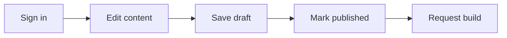
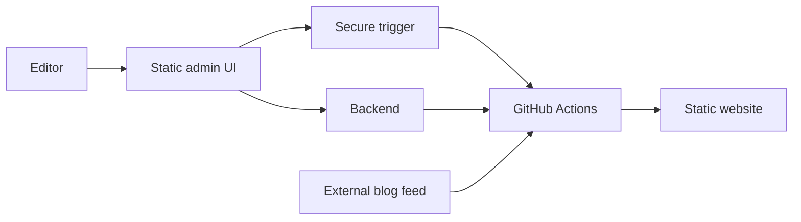

<!-- 5xl -->
# Low-Cost Headless CMS and Static Site Generator

Initial technical proposal and implementation plan

Author: Kaan Saffet Cicu  
Neptun: BY55CS  
Supervisor: Gergely LABORCI  
Project ID: 2026-LG-03

---

## Specification summary

- Affordable, editable websites for small organisations.
- Owners manage sites and permissions; editors manage content.
- Visitors browse a generated static website.
- MVP: pages, structured records, files, one restaurant demo and one template.
- External blog feed; no reservations, orders or payments.

---

## Main user journeys and requirements

- Owners configure sites and editor access.
- Backend validates permissions, fields, slugs and uploads.
- Only published content and approved public files enter the build.

---

## Initial technical proposal

- SvelteKit and TypeScript for admin and static generation.
- GitHub Actions for building and deploying.
- No continuously running public rendering server.

---

## Technology selection and data model

| Backend candidate | Main trade-off |
| --- | --- |
| Supabase (preferred candidate) | Integrated relational data, auth and storage; quotas |
| Firebase | Managed services; usage-based costs |
| Self-hosted | More control; maintenance and server costs |

**Data model:** Users, Memberships, Sites, Pages, Records, Files and Builds. Memberships define site-specific roles; pages and records have publication states.

Final choice depends on verified pricing, limits, security and feasibility.

---

## Secure publishing and validation

- Verify identity and site permissions before triggering a build.
- Keep privileged credentials server-side.
- Generate only published content; fetch external blog posts.
- Deploy only after a successful build; otherwise keep the old site.
- Test menu price updates, cross-site access, draft exclusion, invalid uploads and failed builds.

---

## Semester-2 implementation plan

1. Compare backend options and finalise the data model.
2. Implement authentication, roles and site settings.
3. Build page, record and file editing.
4. Create the restaurant template and integrate the blog feed.
5. Implement secure publishing and static deployment.
6. Run acceptance tests, measure costs and document results.

Track progress in GitHub Projects.

---

## Open risks and next steps

| Risk | Planned validation |
| --- | --- |
| Unauthorised access | Test two users and two sites |
| Exposed secrets or drafts | Inspect public build output |
| Build or blog feed failure | Test failure handling and fallback |
| Hosting costs and quotas | Compare services and measure builds |

**Next:** validate the backend choice, finalise the schema and prototype secure publishing.

**Thank you for listening.**
